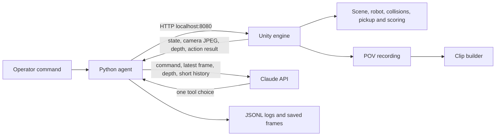

# RoboHalo

**Vision-guided robot fetching in simulation, with a path toward factory material handling.** RoboHalo began as a Membrane Robot Hackathon prototype: give a TurtleBot-style robot a plain-language instruction, let it inspect a forward camera, retrieve a matching colored shape, and deliver it to a marked zone. The current work includes a Unity engine, local robot HTTP API, Python runners, a Claude agent, run logs, and clip tooling. The warehouse scene is an active local integration and is separate from the version-controlled baseline.

## Project status and source of truth

| Area | Location | Status |
| --- | --- | --- |
| Version-controlled baseline | `engine/` in this repository | Unity scene, robot API, six task objects, Python agents and documentation. |
| Active warehouse integration | `E:\turtlebot3-unity-rossharp-main\turtlebot3-unity-rossharp-main` | Separate local Unity project using the imported warehouse and TurtleBot3 model. It is **not automatically synced** into this repository. |
| GitHub | [Srinidhi0604/RoboHalo](https://github.com/Srinidhi0604/RoboHalo) | Public remote. The remote may lag local uncommitted work; use the local files for current behavior. |
| Upstream robotics example | [prakash-aryan/turtlebot3-unity-rossharp](https://github.com/prakash-aryan/turtlebot3-unity-rossharp) | Separate ROS 2/ros-sharp reference project used for the warehouse integration. |

This README describes implemented behavior where confirmed in code. The [PRD](PRD.md) and [Phase 1 specification](spec.md) describe goals and acceptance criteria; they are not proof that every gate has passed.

## What the demo does

The baseline Unity scene has a TurtleBot3 Burger visual, six primitives (red sphere, red cube, blue sphere, blue cube, yellow cylinder and yellow cone), a green drop zone, a forward robot camera and an overview camera. The engine owns object positions, physics checks, pickup attachment, state and final scoring. The agent may receive camera pixels, a single depth reading and permitted robot state, but not object labels or ground-truth positions. Hardcoded runners are available for checking movement and delivery without an API key; their decisions are **not** image-driven.

The active warehouse branch of development places the same task in a decorated warehouse, using the actual imported TurtleBot3 visual with the manual movement controller. Warehouse fixtures are retained as background; individual props in the play area are hidden and made non-colliding. The local warehouse script has evolved separately, so copy its changes into this repository and review them before calling the GitHub code equivalent.

## Technical architecture



| Component | Responsibility | Main files |
| --- | --- | --- |
| Unity engine | Renders scene and camera; serves HTTP; advances robot; handles collisions, pickup, drop and outcomes. | `engine/Assets/Scripts/RobotEngine.cs`, `engine/Assets/Scenes/RoboHalo.unity` |
| Claude agent | Sends the command and current permitted observations to Claude, validates one tool call per step, applies it to Unity and logs the result. | `agent/run_agent.py` |
| Local runners | Exercise movement and delivery without a model. They use privileged or fixed coordinates and must be labeled as demonstrations. | `agent/manual_agent.py`, `agent/builtin.py` |
| Evidence pipeline | Stores camera frames and JSONL decisions; builds a short robot POV video. | `agent/clip.py`, `runs/` |
| Product and hackathon contract | Requirements, states, acceptance gates and future roadmap. | `PRD.md`, `spec.md`, `spec_problem.md` |

The control loop is: **Idle → Locate → Go to object → Pick up → Carry → Drop → Done**. A collision enters **Blocked**; repeated collisions can produce `fail_collision`. Terminal outcomes include `pass`, `fail_wrong_object`, `fail_not_reached` and `fail_collision`. The engine knows the true target for scoring; the vision agent is intended to infer it from observations.

### Local HTTP interface

Start Unity Play mode or a built player before calling the API. The baseline binds to `http://127.0.0.1:8080/`.

| Method and path | Purpose |
| --- | --- |
| `POST /start` | Begin a command; body `{"command":"Bring the round red thing"}`. |
| `GET /state` | Robot state, ground position, heading, holding flag, retries and outcome. |
| `GET /look` | Current robot camera JPEG, 640×480 in the Phase 1 baseline. |
| `GET /depth` | Forward distance reading or `null`. |
| `POST /move` | Move by a signed distance in metres, reporting collision and progress. |
| `POST /turn` | Turn by signed degrees. |
| `POST /pickup` | Snap an eligible nearby object to the robot. |
| `POST /drop` | Release the held object and score the delivery. |
| `POST /reset` | Restore the baseline scene for another run. |

The active warehouse project also has an on-screen controller for quick presets and sequential commands. Check that project's current script for its exact endpoints and behavior; its runtime and this repository's `engine/` are not interchangeable.

## How we built it in phases

| Phase | Work completed or planned | Evidence and remaining gate |
| --- | --- | --- |
| 0. Problem definition | Converted the hackathon brief into a full product PRD and a Phase 1 build contract. | `PRD.md`, `spec.md`. |
| 1. Simulation baseline | Built the Unity room, TurtleBot visual, repeated colors and shapes, drop zone, movement/collision state machine and local HTTP API. | Open `RoboHalo.unity`; inspect `/state` and `/look`. |
| 2. No-key movement | Added manual and built-in runners to check pickup, carry, drop and logging before spending model calls. | `agent/manual_agent.py` and `agent/builtin.py`; these are scripted demos. |
| 3. Vision agent | Added the Claude tool loop, one-action validation, frames, history and JSONL evidence. | `agent/run_agent.py`; camera-driven pass rates still require live demonstration. |
| 4. Warehouse integration | Imported the warehouse sample and TurtleBot3 model into a separate local Unity project, enlarged and cleared the work area, and kept decorative assets around it. | Active local integration; merge into this repo before treating it as a reproducible release. |
| 5. Video and feedback | Added POV clip generation. Hackathon feedback upload and full judged-run evidence remain product work. | `agent/clip.py`; see PRD for the Phase 2 acceptance gate. |
| 6. Productization | Proposed operator UI, mission scheduling, analytics, safety controls and site integration. | Roadmap, not implemented. |

## Run the version-controlled demo

1. Install **Unity 6000.6.3f1** via Unity Hub. The project version is recorded in `engine/ProjectSettings/ProjectVersion.txt`.
2. Open the `engine/` directory as a Unity project, then open `Assets/Scenes/RoboHalo.unity`.
3. Press **Play**. Keep Unity running while using the Python commands below.
4. From this repository root, install the Python dependency: `python -m pip install -r requirements.txt`.
5. Start with a no-key run: `python -m agent.manual_agent "Bring the round red thing"`.
6. For the camera-driven agent, set `ANTHROPIC_API_KEY` in your shell and run `python -m agent.run_agent "Bring the round red thing"`. Use `--no-record` if you do not need a clip.

Example PowerShell API check:

```powershell
Invoke-RestMethod http://127.0.0.1:8080/state
Invoke-WebRequest http://127.0.0.1:8080/look -OutFile robot-view.jpg
Invoke-RestMethod http://127.0.0.1:8080/start -Method Post -ContentType application/json -Body '{"command":"Bring the round red thing"}'
```

Run evidence is saved under `runs/` and may include `run.jsonl`, camera frames and `clip.mp4`. Keep API keys out of source control. The repository's `.gitignore` is intended to exclude generated Unity caches, builds and run artifacts.

### Active warehouse demo

Open `E:\turtlebot3-unity-rossharp-main\turtlebot3-unity-rossharp-main` in Unity Hub, open `Assets/Scenes/Tbot3SampleEnv.unity`, and press Play. Its `Assets/Scripts/RobotEngine.cs` constructs the warehouse task at runtime. The full warehouse model is imported from the upstream Unity/ros-sharp project; the RoboHalo controller provides the hackathon fetch behavior. Press the on-screen preset or enter a command. For a fresh baseline, use **Reset**. This local project is not part of a clean clone of RoboHalo yet.

## Scope, limitations and verification

- The fixed-path runners know object positions. Use the Claude runner and inspect frame/tool logs when demonstrating visual reasoning.
- A successful script build or HTTP response does not prove unattended completion, frame rate, collision recovery or a valid judged clip. Record and inspect live runs for those claims.
- The local warehouse scene includes imported third-party assets. Preserve their licenses and attribution when distributing a merged project. The baseline TurtleBot asset attribution is in `engine/Assets/Models/TurtleBot/ATTRIBUTION.md`.
- ROS 2 SLAM and Nav2 are capabilities of the separate upstream example; this repository's fetch demo is driven by its own local HTTP controller. ROS deployment is future integration work.
- Useful checks: `python -m unittest discover -s tests -p "test_*.py" -v`; with Unity playing, `python tests/smoke_engine.py`. Check `spec.md` for the full acceptance matrix.

## Manufacturing product pitch

**Proposed product:** a vision-led robot task platform for intralogistics. A factory worker asks for a tagged bin, spare part or inspection kit in ordinary language. The platform turns that request into a constrained mission, sends it to a mobile robot, verifies the pickup and delivery, and records the result for supervisors. RoboHalo's current colored-shape fetch is the small simulation of that workflow.

**Initial buyer:** a manufacturing or warehouse operations lead managing repetitive short-distance material moves. **Initial use case:** line-side replenishment between a staging area and a marked delivery station, beginning with a narrow catalog and controlled routes. The same architecture can support kitting, tool delivery, returns and inventory spot checks after validation.

**Why the prototype matters:** Unity provides a digital test floor; the robot camera creates the observation boundary; the agent records decisions; the controller stops at collisions and exposes outcomes. This makes it possible to demonstrate the sequence and audit why a task succeeded or failed before testing with real hardware.

**Pilot proposal:** start with one site, one route, a small set of known containers, supervised operation and human confirmation at pickup/drop. Measure task success, wrong-item rate, intervention rate, time per delivery and operator time saved against the current manual process. Expand only after repeatable results and a safety review. Pricing could combine a site subscription for task orchestration and analytics with a per-robot integration fee; this is a commercial hypothesis, not a current offering.

**Production roadmap:** replace shape matching with SKU or label recognition and confidence thresholds; add a fleet/mission service, authentication and audit logs, WMS/MES connectors, mapping/localization, safety-rated stopping and human override, hardware adapters, and offline/retry behavior. ROS 2/Nav2 can become a navigation integration; the language model should propose actions within explicit robot and site limits.

## References

- [RoboHalo GitHub repository](https://github.com/Srinidhi0604/RoboHalo)
- [Upstream TurtleBot3 Unity and ROS 2 example](https://github.com/prakash-aryan/turtlebot3-unity-rossharp)
- [Product requirements](PRD.md)
- [Phase 1 build specification](spec.md)
- [TurtleBot asset attribution](engine/Assets/Models/TurtleBot/ATTRIBUTION.md)
